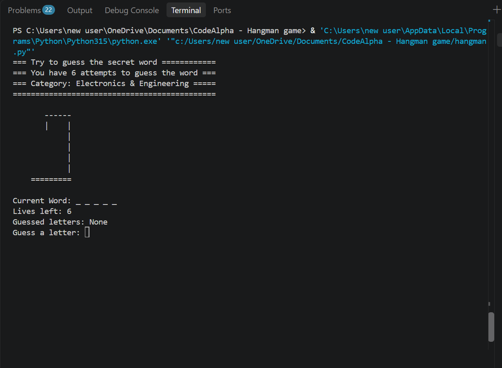
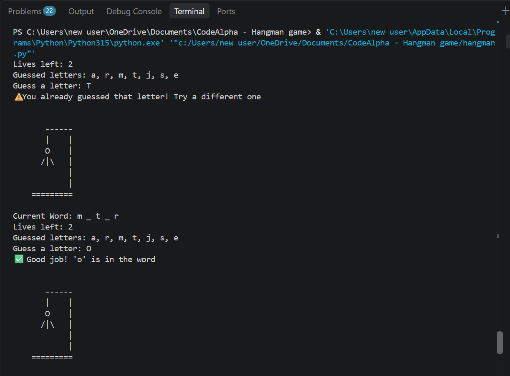
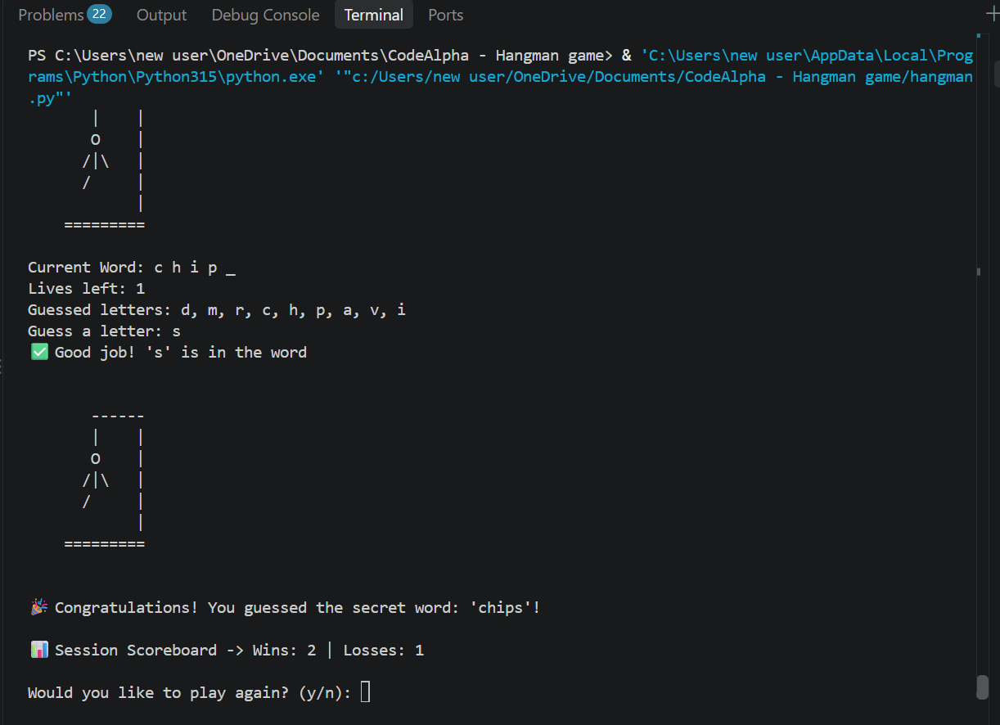
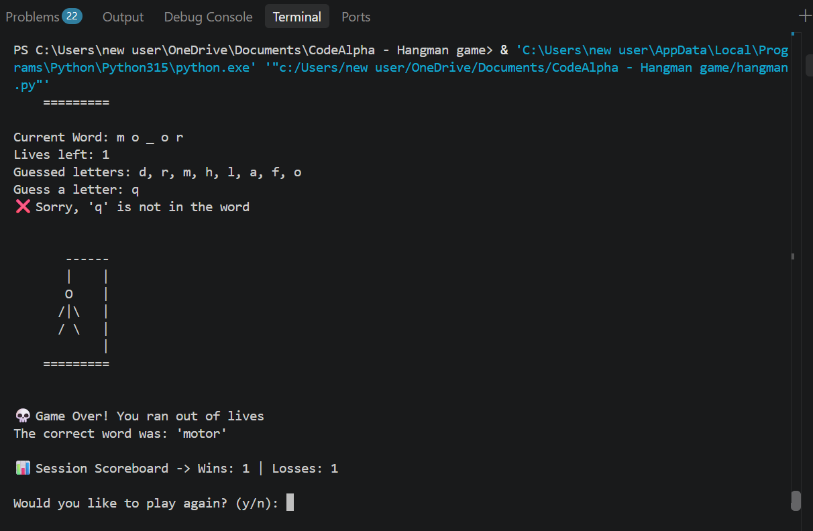
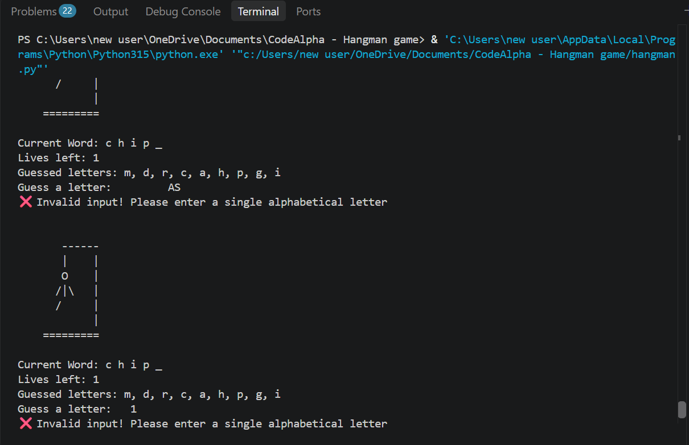

# CodeAlpha Hangman Game

**A beginner-friendly Hangman game built with Python as part of the CodeAlpha Python Programming Internship.**

**Author:** RAFFYDEX  
**Editor:** Visual Studio Code  
**Main File:** `hangman.py`  
**GitHub Repository:** [CodeAlpha Hangman Game](https://github.com/raffydex/CodeAlpha_Hangman_Game)

## 1. Introduction

This project is a console-based implementation of the classic Hangman word-guessing game, developed using Python.

The project was undertaken as part of the CodeAlpha Python Programming Internship. My goal was not only to complete the assignment but also to strengthen my understanding of Python fundamentals and improve my programming and problem-solving skills.

I chose Electronics and Engineering as the word category because of my interest in the field and my background as an Electrical and Electronics Engineering student.

## 2. Project Objectives

The main objectives of this project were to:

- Practise fundamental Python programming concepts.
- Understand how to use loops, conditional statements, lists and functions.
- Apply random word selection in a simple game.
- Develop logical thinking and problem-solving skills.
- Build a working program by combining different programming concepts.

## 3. Game Features

- **Random Word Selection:** Selects a secret word using Python's `random.choice()`.
- **Five Predefined Words:** Uses five Electronics and Engineering-related words.
- **Six Attempts:** Players have a maximum of six incorrect guesses.
- **ASCII Hangman Graphics:** Displays the Hangman drawing as incorrect guesses increase.
- **Word Progress Display:** Shows correctly guessed letters and hides the remaining letters.
- **Input Validation:** Rejects invalid entries such as numbers, symbols and multiple characters.
- **Duplicate Guess Prevention:** Prevents players from guessing the same letter repeatedly.
- **Lives Counter:** Displays the number of attempts remaining.
- **Session Scoreboard:** Tracks wins and losses during the current session.
- **Replay Option:** Allows players to start another round without restarting the program.

## 4. Technologies and Tools Used

| Technology / Tool | Purpose |
|---|---|
| Python 3 | Main programming language |
| Visual Studio Code | Code editor |
| GitHub | Source code hosting and project portfolio |

## 5. Python Modules and Programming Concepts

### Module Used

- `random` – Used to randomly select a secret word from the predefined word list.

### Programming Concepts Applied

- **Variables and Constants:** Store game settings and changing game information.
- **Lists:** Store predefined words, guessed letters and Hangman drawing stages.
- **Dictionaries:** Maintain the session scoreboard using wins and losses.
- **Functions:** Organise the game logic inside `play_hangman(score)`.
- **While Loops:** Keep the game running while the player has attempts remaining.
- **For Loops:** Display the secret word progressively.
- **Conditional Statements:** Check correct guesses, incorrect guesses, invalid inputs and winning conditions.
- **Strings:** Handle words, player input and displayed messages.
- **Boolean Logic:** Evaluate game conditions, including whether all letters have been guessed.
- **List Methods:** Use operations such as `append()` to keep track of guessed letters.

## 6. Game Rules

1. The game randomly selects one word from five predefined words.
2. The selected word belongs to the Electronics and Engineering category.
3. The player guesses one alphabetical letter at a time.
4. Correct guesses reveal the corresponding letters.
5. Incorrect guesses reduce the remaining attempts by one.
6. Players have a maximum of six incorrect guesses.
7. Invalid and repeated guesses do not consume an attempt.
8. The player wins by correctly guessing every letter before running out of attempts.
9. The player loses when all six incorrect attempts have been used.

### Predefined Words

- Diode
- Relay
- Chips
- Motor
- Cables

## 7. How the Game Works

The program follows this basic sequence:

1. Import the `random` module.
2. Store the five predefined words in a list.
3. Randomly select a secret word.
4. Initialise the incorrect guess counter and guessed letters list.
5. Display the game instructions and current Hangman stage.
6. Request a letter from the player.
7. Validate the player's input.
8. Check whether the letter has already been guessed.
9. Compare the guess with the secret word.
10. Reveal correct letters or increase the incorrect guess counter.
11. Check whether the player has won or lost.
12. Update the session scoreboard.
13. Ask whether the player wants to play again.

## 8. Project Structure

```text
CodeAlpha_Hangman_Game/
│
├── hangman.py
├── README.md
│
└── screenshots/
    ├── welcome.png
    ├── gameplay.png
    ├── win.png
    └── game-over.png
```

## 9. Installation and Execution

### Prerequisites

- Python 3 installed on your computer.
- A code editor or terminal.

### Steps

**Step 1: Clone the repository**

```bash
git clone https://github.com/raffydex/CodeAlpha_Hangman_Game.git
```

**Step 2: Navigate into the project directory**

```bash
cd CodeAlpha_Hangman_Game
```

**Step 3: Run the program**

```bash
python hangman.py
```

Alternatively, on Windows:

```bash
py hangman.py
```

No external Python packages are required.

## 10. Screenshots and Gameplay Demonstration

The following screenshots demonstrate the different features and stages of the Hangman game.

### Welcome Screen


### Gameplay


### Winning Screen


### Game Over


### Input Validation


## 11. Development Journey

Developing this project was an opportunity to move beyond simply learning Python syntax and start applying different concepts together.

During development, I worked on understanding how variables, lists, loops, functions and conditional statements interact to produce a complete working program.

I also used YouTube tutorials and AI tools to help me understand some complex concepts and resolve difficulties encountered during implementation.

One important lesson from this experience was that even a small mistake can affect the behaviour of an entire program. Debugging, checking conditions carefully and understanding how different parts of the code connect became important parts of my learning process.

## 12. Challenges Encountered

My biggest challenge was combining all the different components into one working program.

Some of the areas that required attention included:

- Understanding the interaction between loops and conditional statements.
- Implementing the correct win and loss conditions.
- Managing guessed letters and preventing repeated guesses.
- Ensuring invalid inputs did not affect the player's attempts.
- Connecting the game logic, scoreboard and replay functionality.

Working through these challenges helped me appreciate the importance of logical thinking, testing and debugging in software development.

## 13. Key Learning Outcomes

Through this project, I gained practical experience in:

- Applying fundamental Python concepts.
- Breaking a problem into smaller logical steps.
- Organising code with functions.
- Working with lists and dictionaries.
- Implementing input validation.
- Understanding game logic and program flow.
- Identifying and correcting programming errors.
- Combining individual components into a functional application.

Most importantly, I learned that programming requires patience, attention to detail and consistent practice.

## 14. Future Improvements

Possible improvements for future versions include:

- Adding more word categories.
- Introducing different difficulty levels.
- Expanding the word collection.
- Adding a persistent scoreboard.
- Developing a graphical user interface.

These are future ideas and are not part of the current assignment version.

## 15. Acknowledgements

- **CodeAlpha:** For providing the Python Programming Internship opportunity and project assignment.
- **YouTube Educators:** For tutorials and additional learning resources.
- **AI Learning Tools:** For helping me understand complex programming concepts and work through implementation challenges.

---

**Project:** CodeAlpha Hangman Game  
**Language:** Python  
**Author:** RAFFYDEX

*Built as a learning project, with a focus on understanding Python fundamentals and improving problem-solving skills.*